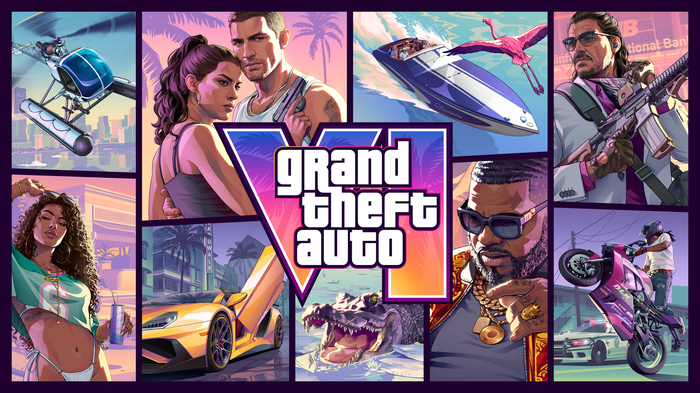

# GTA VI · Fim de Capítulo

Guia rápido com as missões que encerram cada capítulo do **GTA 6** e o que fazer **antes** delas pra não perder nada.

🔗 **Acesse:** https://raphaelfuchter.github.io/gta6-capitulos/

## Resumo

| Capítulo | Última missão | Antes dela |
|---|---|---|
| 1 | Armadilha para turistas | "Compre o rum da Shirley", "Roube a scooter", meditação com a Lucia (após "Com os pés no chão"), depositar US$ 5.000 |
| 2 | Fazendo o check-out | 2 cartas e 2 revistas no motel; exige US$ 15.000 |
| 3 | O Assalto ao Cartel | "Corrida contra Yago" (só com Jason), 2 revistas do apartamento |
| 4 | Começando do zero | Opcional da Lucia ("Esta é uma chamada gratuita de..." — nome em PT não confirmado); Ultimate Edition: barco em Washington Beach |

## Sobre

Página estática (HTML + CSS, sem build), publicada pelo GitHub Pages a partir da branch `main`. Funciona no celular.

---

Guia não oficial feito por fã, sem afiliação com a Rockstar Games. Imagens © Rockstar Games.
